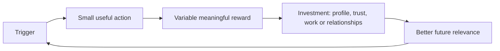
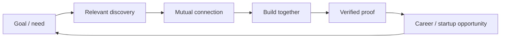
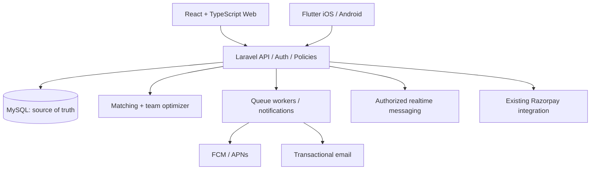

# NIGHTCLUB — HOOKED PRODUCT & FEATURE LOOP BLUEPRINT

**Brand:** Founder Labs by Nitish · Nightclub  
**Document:** `NIGHTCLUB_HOOKED_PRODUCT_BLUEPRINT.md`  
**Version:** 1.0 · 13 November 2026  
**Status:** Product architecture baseline — implementation specs will be authored in subsequent Markdown files.

---

## 0. Executive product decision

**Nightclub is an intelligent builder execution network** for students, developers, designers, marketers, creators, founders, operators, and career switchers. Its job is to turn a member's **goals + abilities + gaps** into **the right introductions + shared work + verified outcomes**.

**Positioning:** GitHub records code; Dribbble showcases design; LinkedIn represents professional experience. **Nightclub helps complementary people meet, build, prove their contributions, and unlock opportunities together.**

**Success is not screen time.** Success is people meeting productive collaborators, completing projects, earning credible proof of work, securing opportunities, and returning to build again.

### Fixed decisions

- Audience: Telugu AI community at launch; multilingual/international expansion possible.
- Membership: paid monthly Nightclub subscription. Existing live session benefits are preserved; initial product assumption is **eight included paid build sessions/month**, configurable by admins, not hardcoded.
- Matching: dynamically balances **startup-building and career opportunities** based on each member's declared goals, which members can update anytime.
- Signature onboarding experience: **Find Your Four**, four complementary, opt-in introductions intended to form a five-person builder circle.
- Identity and communication: mandatory minimum viable profile before matching; personal contact details hidden; accepted connections can use in-app chat.
- Platforms: **Flutter for iOS and Android**; **React + TypeScript for web**; **existing Laravel/PHP + MySQL backend** stays the source of truth, extended through versioned APIs. Flutter Web is an option to revisit only if a unified client stack becomes more important than a distinct, SEO-friendly web experience.
- No automatic permanent group assignment without members' consent. No forced phone-number disclosure.

---

## 1. Engagement philosophy: the Hooked Model, implemented ethically

This document uses the four-step **Hooked Model** associated with Nir Eyal:

1. **Trigger:** Why does a member think of Nightclub or receive a relevant prompt?
2. **Action:** What is the smallest useful action they can take in seconds?
3. **Variable reward:** What meaningful *uncertain outcome* results from the action (e.g., a new collaborator, response, useful feedback, or opportunity)? No artificial random prizes.
4. **Investment:** What useful effort or data do they add (skills, a project update, a contribution, a preference), making future recommendations and collaboration more valuable?



**Guardrails:** Reject endless scroll, fake scarcity, manufactured urgency, deceptive badges, synthetic social proof, excessive push alerts, forced check-ins, loss-aversion threats, and mandatory notifications. A member must be able to pause, mute, unfollow, leave a circle, and delete their account/data according to policy. Prioritize *time well spent* and member outcomes over compulsive use.

### Engagement rules for every feature

- Each feature needs a real **job-to-be-done**, one primary action, one *honest* feedback signal, and a corresponding next helpful step.
- Prefer actionable reasons to return over broad broadcast announcements.
- Treat variable reward as unpredictability in real human collaboration or discoveries, **not an engineered slot-machine mechanism**.
- Prefer explicit user preferences to inferred psychological vulnerabilities.
- Notify only where there is a plausible next action; support digests and opt-outs.
- Never claim a match score is a probability of friendship, success, employment, or compatibility.

---

## 2. The macro-loop: Nightclub's one main circle

**Trigger:** A project idea, career goal, missing skill, relevant session, or specific teammate invitation.  
**Action:** Open one personalized recommendation; introduce yourself, join a build, or contribute.  
**Reward:** A responsive teammate, useful feedback, visible progress, completed demo, portfolio proof, or real opportunity.  
**Investment:** Improve your persona, accept a collaboration, contribute work, document proof, give feedback, and build trust.  
**Next trigger:** A *genuine* next milestone, reply, peer contribution, session, or more relevant recommendation.



**North Star:** `weekly_meaningful_collaborators` = number of distinct members who participated in at least one evidence-backed collaboration action during a trailing 7-day window. Count each member once per week. Define qualified actions explicitly (accepted deliverable, merged code review, acknowledged design, shipped milestone, verified live demo). Exclude passive opens, likes, and self-reported unverified claims.

**Countermetrics:** notification opt-outs, blocks/reports, match declines, chat harassment reports, member overload, uncompleted commitments, refund requests, and cancellations.

---

## 3. Hooked circles for every key feature

The following feature cards are the canonical product loops. Each has **Trigger → Action → Variable reward → Investment → Next trigger** and a measurable success criterion.

### F01 — Mandatory minimum viable onboarding / Builder Persona

- **Job:** Convert an unknown member into an editable, useful matching profile.
- **Trigger:** First successful authenticated entry after payment or signup.
- **Action:** Select current role, primary and secondary skills, capabilities offered, capabilities sought, goals, interests, availability, language, and privacy settings. Add optional portfolio evidence.
- **Variable reward:** An understandable persona summary and an initial set of relevant collaboration opportunities (actual matches only if eligible inventory exists).
- **Investment:** Confirm or correct skills/goals; add work samples and collaboration preferences.
- **Next trigger:** Profile completeness suggestion only when it unlocks a useful recommendation or capability.
- **Success:** Minimum viable profile completion, median onboarding duration, matching consent rate, profile correction rate.
- **Guardrail:** Never require public phone, social handles, precise location, or unnecessary sensitive information. Let members edit and revoke inferred tags.

### F02 — Builder Chemistry: people matching

- **Job:** Recommend people who complement each other and have mutual reasons to connect.
- **Trigger:** Completed persona, new goal, new skill gap, new eligible member, or genuinely improved match.
- **Action:** Review one recommendation and its **Why this match?** explanation; request, save, or dismiss.
- **Variable reward:** A relevant person with complementary skills or aligned intentions, possibly a mutual acceptance.
- **Investment:** Give reasoned feedback (interested/not now/wrong skill), update needs, and report outcomes after collaboration.
- **Next trigger:** An accepted request or materially better, available recommendation (not a trivial score change).
- **Success:** mutual acceptance, meaningful first conversation, collaboration within 7 days, fairness by member cohort.
- **Guardrail:** No misleading '96% chance of success'. Score is internal normalized ranking and may be exposed as a descriptive match tier.

### F03 — Find Your Four

- **Job:** Offer four complementary, available introductions with coverage across distinct capabilities.
- **Trigger:** Persona completion or meaningful change in project direction, and sufficient opted-in inventory.
- **Action:** Review the four profiles and each role's proposed contribution; request introductions individually or propose a circle invitation.
- **Variable reward:** A coherent, diverse team recommendation with consenting members and possible shared project alignment.
- **Investment:** Express collaboration intent, accept or decline, add project goals, and agree availability.
- **Next trigger:** Member acceptance, completed formation, or a replacement proposal after a real decline.
- **Success:** introduction acceptance, circles formed, team skill coverage, day-14 project activation.
- **Guardrail:** No automatic enrollment; avoid popularity monopolies and repeatedly bothering the same users. Display fewer than four rather than fabricate matches; use a waitlist when necessary.

### F04 — Connections and privacy-safe direct messaging

- **Job:** Turn suitable introductions into meaningful two-way conversations.
- **Trigger:** Someone accepts a request, sends a message, or responds to an explicit collaboration invitation.
- **Action:** Send a context-aware first message with optional prompts about goals and availability.
- **Variable reward:** A useful reply, a shared interest, a meeting agreement, or a project invitation.
- **Investment:** Build conversation context, save relevant goals, and confirm preferred working format.
- **Next trigger:** Actual reply, mention, approved invite, or agreed follow-up.
- **Success:** mutually active conversations, conversations progressing to a mission, median time to first relevant reply.
- **Guardrail:** Never expose personal contact data by default. Connection acceptance grants in-app messaging, not email/phone access. Block/report controls and rate limiting are mandatory.

### F05 — Builder Circles / team workspaces

- **Job:** Give collaborators a shared home with accountability and continuity.
- **Trigger:** Group invitation accepted or a group formed around a validated project idea.
- **Action:** Confirm objective, deliverables, ownership, cadence, and communication norms.
- **Variable reward:** A member takes ownership, uncovers a solution, or moves a shared objective forward.
- **Investment:** Commit a role, schedule a milestone, upload a deliverable, acknowledge peers' work.
- **Next trigger:** A teammate completes a deliverable or requests input on a specific task.
- **Success:** active circles, committed deliverables, milestone completion, balanced contribution.
- **Guardrail:** Support two-to-five-person teams and larger circles if justified. Do not pressure users to form exactly five-person teams or accept more work than they have time for.

### F06 — Build Missions / collaborative project execution

- **Job:** Replace passive networking with a small, achievable real-world build.
- **Trigger:** A circle is formed, a session starts, or a member finds a mission matching their goal.
- **Action:** Claim one deliverable, add an artifact, request review, or mark a verifiable milestone complete.
- **Variable reward:** An unexpected useful idea, successful integration, real tester feedback, or demonstrable progress.
- **Investment:** Source link, prototype, evidence, milestone notes, peer review, and documented learning.
- **Next trigger:** Actual review, integration dependency, release deadline agreed by the team, or new tester feedback.
- **Success:** weekly active missions, verified milestones, shipped demos, real-user feedback.
- **Guardrail:** No fake countdowns or progress bars. Missed milestones should prompt a supportive rescope rather than shame.

### F07 — Builder Passport / verified contribution portfolio

- **Job:** Make collaborative work visible and portable as professional proof.
- **Trigger:** A contribution is accepted, a project ships, or a member requests shareable proof.
- **Action:** Publish a project story including role, artifact, outcomes, and optional contributor acknowledgments.
- **Variable reward:** Constructive recognition, a credible reference, a relevant opportunity, or project interest.
- **Investment:** Add evidence and maintain accurate contribution metadata; request consensual team validation.
- **Next trigger:** Verified new contribution, review invitation, portfolio feedback, or a relevant opportunity.
- **Success:** verified contributions per member, meaningful portfolio shares, opportunities originating from proof.
- **Guardrail:** Distinguish 'self-reported', 'peer-acknowledged', and 'artifact-verified'. Do not fabricate endorsements or expose confidential client work.

### F08 — Live session hub / monthly paid sessions

- **Job:** Turn the membership's live learning into collaboration and shipping.
- **Trigger:** Upcoming session relevant to member's goals, opt-in calendar reminder, or live room opening.
- **Action:** RSVP, prepare environment, join session, claim an experiment, or submit a demo.
- **Variable reward:** New technical insight, completed experiment, peer discovery, or usable starter project.
- **Investment:** Save notes, code, outcome, and next build step in the member workspace.
- **Next trigger:** One useful follow-up task tied to what the member actually built during the session.
- **Success:** attendance-to-build conversion, session demo submission, collaboration spawned per session.
- **Guardrail:** Admin-configurable session count, schedule, links, and entitlements; prevent unauthorized link exposure. RSVP should not imply attendance.

### F09 — Opportunities: startup, jobs, freelance, early customers

- **Job:** Turn demonstrated ability into opportunities that suit the member's objectives.
- **Trigger:** New relevant, legitimate opportunity; completed portfolio artifact; member updates goals.
- **Action:** Inspect fit rationale; express interest, apply, pitch, or request introduction.
- **Variable reward:** A real employer response, paid assignment, cofounder conversation, pilot customer, or useful rejection feedback.
- **Investment:** Tailor evidence, update preferred opportunities, log outcome, and maintain proof of skills.
- **Next trigger:** Actual response or a better-verified fit—not repeated reminders to apply to the same item.
- **Success:** qualified applications, genuine replies, pilots started, interviews, paid project outcomes.
- **Guardrail:** Verify opportunity legitimacy; clearly separate community introductions from hiring guarantees. Employer/admin access to contact data requires member consent.

### F10 — Builder Feed / discovery (not a generic engagement feed)

- **Job:** Help members discover useful projects, collaborators, lessons, and problems.
- **Trigger:** New work from followed people, relevant milestone, or a specific interest search.
- **Action:** Inspect a project and leave substantive feedback, save it, or ask to contribute.
- **Variable reward:** Learn a practical technique, discover a project, receive helpful response.
- **Investment:** Publish a build update, add feedback with evidence, follow topics rather than chase popularity.
- **Next trigger:** Actual reply, update from a saved mission, or a relevant new build.
- **Success:** feed-to-collaboration conversion, useful feedback, saved projects later revisited.
- **Guardrail:** Finite ranked feed with 'You're caught up'; no autoplay/infinite-scroll requirement. Do not rank by outrage or raw reactions alone.

### F11 — Member search / intentional discovery

- **Job:** Let members override recommendations and search with clear intent.
- **Trigger:** A specific skill gap or new project need.
- **Action:** Search by skills offered, goals, availability, language, and evidence; view privacy-safe profiles.
- **Variable reward:** An unexpected but relevant candidate or project.
- **Investment:** Save searches and give preference feedback.
- **Next trigger:** Opted-in digest when a genuinely qualifying profile appears.
- **Success:** search-to-request, accepted introductions, searches yielding relevant results.
- **Guardrail:** Respect visibility, blocking, and no-contact preferences in both search and recommendations.

### F12 — Contribution feedback and trust

- **Job:** Improve matching reliability through specific evidence, not popularity contests.
- **Trigger:** Milestone completed or a collaboration ends.
- **Action:** Answer a short structured review: contribution delivered, responsiveness, would-collaborate-again; optional private qualitative feedback.
- **Variable reward:** Better recommendations and useful peer recognition.
- **Investment:** Grounded review data; resolved project outcome; verified evidence.
- **Next trigger:** A demonstrably improved match or relevant follow-up opportunity.
- **Success:** review completion, fraud/abuse flags, calibration against actual collaboration success.
- **Guardrail:** No public low-star shaming, retaliatory ratings, or unappealable hidden reputation. Model trust conservatively with minimum evidence thresholds.

### F13 — Notifications / personal relevance engine

- **Job:** Notify members only when there is a helpful next action.
- **Trigger:** Transaction/security event, received reply, mutual match, requested task review, real milestone, member-selected session reminder, or curated opportunity.
- **Action:** Deep link directly to the relevant conversation, task, or event.
- **Variable reward:** Resolve a pending need, reconnect with a collaborator, unlock useful progress.
- **Investment:** Configure timing/channels/categories; respond; mute or mark irrelevant so the engine learns preferences.
- **Next trigger:** Subsequent actual high-relevance event; digest for lower-priority activity.
- **Success:** notification-to-qualified-action, mute rate, opt-out rate, useful session attendance; not just CTR.
- **Guardrail:** Default limit two **non-essential** push notifications/day; quiet hours based on member timezone; category opt-outs; event dedupe, TTL, per-user throttles. Critical transactional/security events are handled separately.

### F14 — Membership and renewal

- **Job:** Make paid value visible and manage subscriptions transparently.
- **Trigger:** Upcoming renewal, entitlement change, payment success/failure, or relevant subscription benefit.
- **Action:** View plan, sessions included, billing date, renewal status, cancellation options, or update payment method.
- **Variable reward:** Not a gamified feature; predictable access and clearly demonstrated actual value.
- **Investment:** Save billing preferences and optional feedback on missing value.
- **Next trigger:** Renewal receipt, planned payment notice, or a meaningful member-selected update.
- **Success:** retained paying members, completed sessions, resolved payment failures, subscription transparency.
- **Guardrail:** No dark patterns, hidden cancellation, false last-chance claims, or coercive renewal loops. Follow applicable billing and store policy.

### F15 — Moderation, safety, and personal control

- **Job:** Make building with strangers safe and comfortable.
- **Trigger:** Unwanted message, suspicious invitation, abuse report, or privacy concern.
- **Action:** Block, report, leave, mute, restrict visibility, export data, or request deletion.
- **Variable reward:** Not variable: predictable safety and restored control.
- **Investment:** Optional report evidence and preferences that help maintain safety.
- **Next trigger:** Only a factual status update on the member's own report/request.
- **Success:** response SLA, repeat-offender incidence, safety resolution satisfaction.
- **Guardrail:** Safety tools are never restricted by paywall or gamified; handle evidence discreetly and minimize exposure.

---

## 4. Dynamic goals: one member, multiple objectives

A member may want a startup, job, freelance work, collaborators, and experimentation at the same time. Store **explicit per-goal weights** rather than forcing a single identity.

Example editable goal vector:

```json
{
  "startup_building": 0.45,
  "career_jobs": 0.30,
  "freelance_clients": 0.15,
  "learning_experiments": 0.10
}
```

Constraints: weights are each in `[0,1]` and sum to `1.0`; offer simple UI presets and manual adjustment. The system should adapt ranking to the **current task context**: a user browsing cofounders deserves different results from the same user searching internships. Do not silently rewrite expressed ambitions based solely on clicks.

**Matching architecture (V1):**

1. **Eligibility filters:** active/consenting profile, blocked-user exclusions, privacy permissions, available capacity, and any explicit dealbreakers.
2. **Candidate generation:** skills, matching goals, interest tags, desired contributions, timezone overlap; retrieve a candidate pool.
3. **Reciprocal scoring:** A's need for B and B's need for A, plus mutual goals, availability, work-style fit, evidence, and novelty.
4. **Re-ranking:** complementary disciplines, fair exposure, freshness, workload, and member-specific preferences.
5. **Explanation:** show grounded, human-readable reasons and limitations.
6. **Feedback:** accepted/declined invites, meaningful replies, completed missions, member corrections, safety reports.

Initial illustrative pair score:

`pair_score = 0.30*complementarity + 0.25*goal_alignment + 0.15*mutual_interest + 0.15*availability + 0.10*experience_fit + 0.05*perspective_novelty`

All components normalized `[0,1]`. For reciprocal interest, use an aggregation that penalizes one-sided fit (e.g. geometric mean of directional scores) instead of assuming A→B means B→A. The above weights are test hypotheses, **not learned truth**. Evaluate using outcome-based experiments and calibrate over time. Missing evidence should not be interpreted as poor talent.

**Fairness:** new members need exposure opportunities; enforce capacity limits and give each member a chance to opt out of receiving further introductions. Never use protected personal traits for unfair exclusion or infer sensitive traits.

---

## 5. Find Your Four: from person scores to a functioning group

**Input:** focal member `u`, current objective/project needs `G`, consenting candidate pool `C`, project roles/skill taxonomy, availability/capacity.

**Output:** up to four distinct people with: member ID, suggested team contribution, explanation, relevant evidence, and a pending/accepted/declined introduction state.

**Group-level objective (illustrative):**

`team_score = 0.40*skill_coverage + 0.25*collaboration_fit + 0.20*reciprocal_interest + 0.15*perspective_diversity`

Subject to:

- all proposed members eligible and not blocked by one another;
- no member over capacity;
- meaningful overlap for meetings;
- distinct members and adequate combined skill coverage;
- optional project-specific requirements, e.g. at least one technical contributor;
- member consent before group formation.

**Recommended V1 algorithm:** generate 30–100 eligible candidates, use greedy marginal-gain selection for four positions, then evaluate swap improvements (local search). For smaller pools, a bounded combination search may work. Do not simply pick the top four pair scores. In V2, test integer optimization or learning-to-rank only when measurable outcomes justify it.

**Lifecycle:** `generated → intros_requested → partially_accepted → circle_ready → active → completed | archived`. Replacement suggestions are offered after declines/timeouts, never silently swapped into an active group.

**Matrix concept:** a member may be in multiple project circles but cap active roles. Connections form a graph of opt-in working relationships—not an exponential obligation to recruit more people. Track the network's shipped output, not branch count.

---

## 6. Notifications: event-to-action design

### Event classes

| Priority | Examples | Primary channel | Rule |
|---|---|---|---|
| Transactional | Security alert, billing receipt, payment issue | Email/in-app; push as appropriate | Must be accurate; no promotional copy |
| High | Connection accepted, direct message, task review requested | In-app + opted-in push | Immediate if not in quiet hours; otherwise queue where safe |
| Medium | Find Your Four refreshed, session reminder, relevant opportunity | In-app / opted-in push | Respect reminders, quiet hours and relevance |
| Low | Project feedback, passive reactions, discoveries | Digest or in-app | Aggregate and dedupe |

### Delivery decision

`notification_value = relevance * urgency * expected_usefulness * (1 - fatigue)`

Use it as a ranking heuristic only; do **not** invent a predictor's accuracy. Enforce explicit opt-outs and frequency caps **after** scoring. Use direct deep links; no generic 'Come back, we miss you' prompts.

### Delivery architecture

`domain event → outbox → queue/worker → preference check → priority and throttle → render safe template → FCM/APNs/web push/email/in-app → delivery log → qualified outcome`.

- Deduplicate by `{user_id,event_type,object_id,window}`.
- Send only to authorized recipients after permissions are rechecked at delivery time.
- Store delivery state, channel, sent-at, read-at, clicked-at, and qualified action; TTL expired events.
- Quiet hours and timezone are user-managed; no guessed location.
- Push payloads should avoid sensitive content on lock screens when privacy settings demand it.
- Admins can schedule session reminders, with counts for targeted, queued, sent, delivered (where supported), failed, and skipped. Never conflate sent with delivered.
- For conversations, use message grouping, mute settings, and mention/DM preferences.

---

## 7. Platform architecture (updated: Flutter)



- **Flutter:** Dart, reusable feature modules, typed DTOs, token/session management, deep links, secure local credential storage, accessibility, push permissions, Android/iOS app lifecycle, and offline-friendly cached non-sensitive content.
- **Web:** React + TypeScript, responsive UI with distinct desktop workflows; may share API schemas/semantics but not Flutter widgets.
- **Backend:** existing Laravel app and MySQL remain authoritative for accounts, membership, sessions, admin, and payments. New modules should be isolated, migration-driven, and backward-compatible.
- **Auth:** reuse existing identity and enforce server-side entitlement checks; never authorize from a client-side paid flag. Mobile token strategy must be designed against the actual existing auth method.
- **Chat:** authenticated real-time delivery, message persistence, unread state, retries, pagination, moderation, and block enforcement. No direct contact leakage.
- **Queues:** notifications, digest generation, scoring refresh, and evidence processing should not block API requests.
- **AI use:** optionally convert free text into *editable* structured profile suggestions and explain matches; deterministic ranking/eligibility remains testable and auditable.
- **Payments:** keep existing payment integration, but assess App Store / Google Play rules for in-app subscriptions before publishing native builds; do not assume web-only payment flows are permitted inside apps.

---

## 8. Minimum domain entities (conceptual, not migration-ready)

- `users`, `memberships`, `subscription_events`, `session_entitlements`
- `builder_profiles`, `skills`, `member_skills`, `member_goals`, `member_interests`, `member_availability`, `privacy_preferences`
- `portfolio_links`, `builder_artifacts`, `contributions`, `contribution_verifications`
- `match_candidates`, `match_scores`, `match_explanations`, `match_feedback`, `exposure_logs`
- `connection_requests`, `connections`, `blocks`, `reports`
- `circles`, `circle_members`, `circle_invitations`, `circle_roles`
- `missions`, `mission_tasks`, `mission_milestones`, `mission_artifacts`, `mission_reviews`
- `conversations`, `conversation_members`, `messages`, `message_receipts`
- `events`, `session_rsvps`, `session_attendance`, `session_resources`
- `opportunities`, `opportunity_applications`, `opportunity_outcomes`
- `notification_events`, `notification_preferences`, `notification_deliveries`, `device_tokens`
- `audit_logs`, `outbox_events`, `feature_flags`, `analytics_events`

Use foreign keys and indexes as needed; detailed SQL and migrations belong in a separate database spec after inspecting the current production schema.

---

## 9. Product surface and navigation

### Web

**Primary:** Home · Find Your Four · Discover · Circles · Build Missions · Sessions · Messages · Opportunities · Builder Passport.  
**Secondary:** Settings, membership, admin (role-gated), moderation/reporting, notification preferences.

### Flutter mobile

**Bottom navigation (suggested):** Home · Discover · Build · Inbox · Profile.  
**Top-level modules:** Find Your Four card on Home; Circles within Build; live sessions accessible from Home/Build; Opportunities inside Discover with goal-specific filter.

### Home screen order

1. **One next meaningful action** (reply, review task, join live session, accept introduction).
2. **Find Your Four**, with transparent explanations and opt-in states.
3. **Your active build**, with team milestone and responsible next step.
4. **Relevant opportunity** consistent with the member's current goal weighting.
5. **Upcoming membership session**, RSVP/deep link and resources.
6. **Finite discovery**, not an infinite engagement feed.

---

## 10. Phased development priorities and exit criteria

### Phase 0 — Existing-system audit

- Confirm current Laravel version, MySQL schema, auth flows, Razorpay subscription status, membership gates, emails, and administrative session management.
- Record platform constraints, migration plan, security baseline, and design tokens.
- **Exit:** stable API boundaries and a backwards-compatible database plan.

### Phase 1 — Identity, matching and first introductions

- Mandatory minimal persona, goal-weight UI, editable AI suggestions (optional), basic scoring, explanation, Find Your Four, accepted connections, safe 1:1 chat, notification preferences, admin review tools.
- Launch to a limited opt-in cohort; manually review low-quality matches.
- **Exit:** real mutual introductions and qualified conversations without contact data leaks.

### Phase 2 — Collaborate and ship

- Circles, missions, tasks, verified artifacts, Builder Passport, session integration, structured collaboration feedback.
- **Exit:** real members shipping verifiable artifacts together.

### Phase 3 — Opportunities and intelligent personalization

- Startup/career/freelance pathways, trusted opportunity listings, search enhancements, notification tuning, measured recommender improvements.
- **Exit:** traceable interviews, customer pilots, paid gigs, or startup milestones originating from platform activity.

### Phase 4 — Native app optimization

- Production Flutter builds, app-store-compliant entitlements, reliable push/deep links, mobile accessibility, offline-friendly UX, analytics, performance and safety hardening.
- Native work can begin in parallel with Phase 1 once APIs stabilize.

---

## 11. Instrumentation and experiments

### Required event taxonomy

`profile_started`, `profile_completed`, `goal_weights_updated`, `match_impression`, `match_reason_viewed`, `introduction_requested`, `introduction_accepted`, `introduction_declined`, `message_sent`, `first_qualified_conversation`, `circle_created`, `mission_started`, `milestone_verified`, `artifact_published`, `session_attended`, `opportunity_applied`, `opportunity_response_received`, `notification_sent`, `notification_opened`, `notification_qualified_action`, `subscription_renewed`, `subscription_cancelled`, `report_submitted`, `block_created`.

Track user consent, retention rules, minimal properties, and pseudonymous analytics identifiers. Don't log private message bodies or personal contact fields in generic analytics.

### Initial experiments

1. **Onboarding:** essential-fields-only versus longer profile form. Primary: qualified introductions within 7 days; guardrail: abandonment.
2. **Find Your Four:** diversity-aware team selection versus highest pairwise scores. Primary: circle activation/ship rate; guardrail: declines and reported low-quality fits.
3. **Explanation:** plain-language reason versus score-only presentation. Primary: meaningful introduction rate; guardrail: trust feedback.
4. **Reminder delivery:** event-driven versus generic session reminder. Primary: attendance-to-build conversion; guardrail: mute/uninstall rates.
5. **Goal routing:** balanced feed versus member-weighted startup/career routing. Primary: opportunity-to-outcome conversion; guardrail: irrelevant recommendations.

Randomize responsibly, avoid withholding safety/transactional functionality, and do not infer success from notification opens alone.

---

## 12. Feature acceptance checklist

Before a feature is considered implementation-ready, its own detailed spec MUST contain:

- [ ] Specific user job and persona(s)
- [ ] Trigger, action, **real** variable reward, investment, next trigger
- [ ] Expected user value and what would make the feature worth returning for
- [ ] Entry/empty/loading/error/offline states
- [ ] Privacy, consent, abuse, accessibility and opt-out behavior
- [ ] Role permissions and membership entitlement rules
- [ ] Backend entities, API inputs/outputs, event schema, push/deep links
- [ ] Desktop web and Flutter Android/iOS UI states
- [ ] Instrumentation, success metric, guardrail metric, experiment plan
- [ ] Acceptance tests and failure scenarios
- [ ] No hidden phone/email sharing or invented engagement claims

---

## 13. Planned Markdown file family

This file establishes the shared Hooked-loop grammar. Next, generate individual implementation-grade documents based on the requested feature or module:

1. `01_PRODUCT_VISION_AND_USER_JOURNEYS.md`
2. `02_ONBOARDING_PERSONA_AND_SKILL_TAXONOMY.md`
3. `03_RECIPROCAL_MATCHING_ENGINE.md`
4. `04_FIND_YOUR_FOUR_TEAM_OPTIMIZER.md`
5. `05_CONNECTIONS_CHAT_AND_PRIVACY.md`
6. `06_CIRCLES_AND_BUILD_MISSIONS.md`
7. `07_BUILDER_PASSPORT_AND_PROOF_OF_WORK.md`
8. `08_SESSIONS_AND_MEMBERSHIP.md`
9. `09_OPPORTUNITIES_AND_DISCOVERY.md`
10. `10_NOTIFICATIONS_AND_RETENTION_ENGINE.md`
11. `11_LARAVEL_MYSQL_DATABASE_AND_APIS.md`
12. `12_FLUTTER_IOS_ANDROID_APPLICATION.md`
13. `13_REACT_WEB_APPLICATION.md`
14. `14_ADMIN_MODERATION_ANALYTICS_AND_TESTING.md`
15. `15_ROADMAP_RELEASE_GROWTH_EXPERIMENTS.md`

**Rule for subsequent documents:** retain this product's primary loop, Flutter mobile + React web + existing Laravel/MySQL backend, goal-weighted startup/career matching, safe consent-based connections, member-centered notifications, and measurable real-world build outcomes. Do not invent implementation facts about existing production code without inspection.

---

## 14. Final product statement

**Nightclub is where the right people find each other, build something real, and turn that work into their next opportunity.**

**Core product loop:** **Understand me → Find my people → Build together → Prove my work → Unlock my next opportunity → Improve future matching.**

**Anti-goal:** Build a social app that maximizes scrolling and notification interruptions without improving members' lives.
